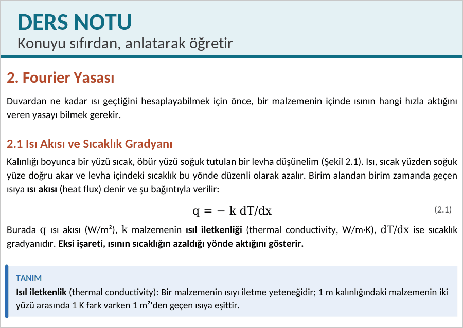
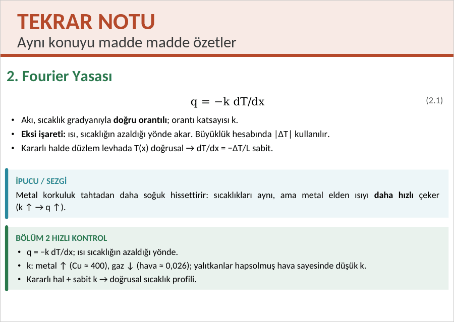
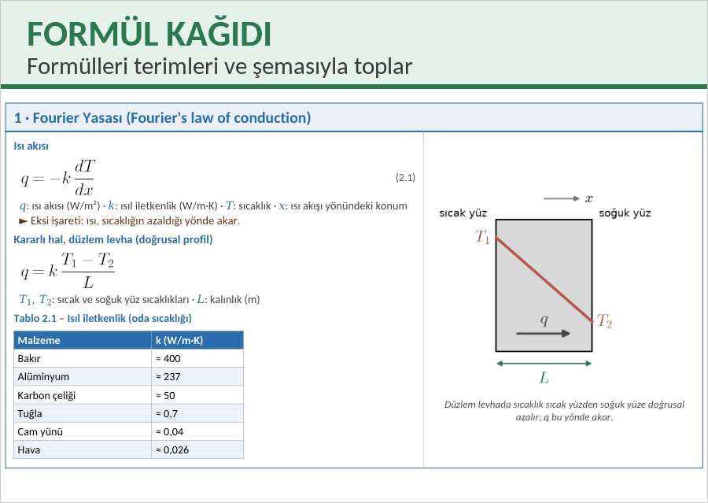
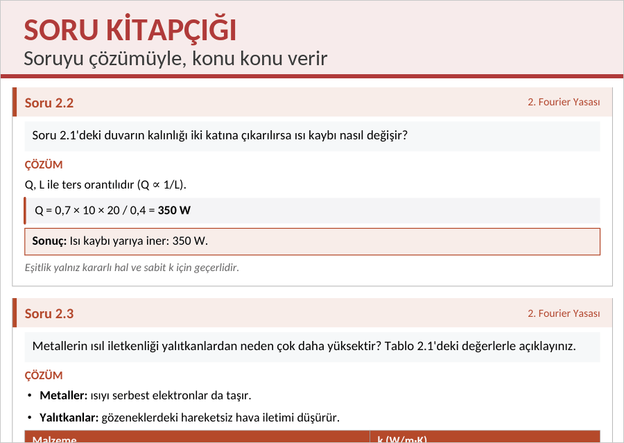

# Ders Notu Yardımcısı

Ders kitabını ya da ders notunu ver, Claude Code sana Türkçe ders notu, tekrar notu, formül kağıdı ve çözümlü soru kitapçığını PDF olarak hazırlasın.

Aynı konu (Fourier yasası), dört farklı çıktı:

<table>
<tr>
<td width="50%" valign="top"></td>
<td width="50%" valign="top"></td>
</tr>
<tr>
<td width="50%" valign="top"></td>
<td width="50%" valign="top"></td>
</tr>
</table>

## Kurulum

Claude Code içinde şu iki komutu çalıştır:

```
/plugin marketplace add Cerhantes/DersNotuYardimcisi
/plugin install ders-notu-yardimcisi@ders-notu-yardimcisi
```

Sonra `/reload-plugins` yaz ya da Claude Code'u yeniden başlat.

Başka bir şey kurman gerekmez. İlk kullanımda skill, gereken Python ortamını 1–3 dakikada kendisi hazırlar. Yönetici şifresi istemez, sistemdeki Python'a dokunmaz.

## Kullanım

Claude Code'a ne istediğini yaz:

> Şu kitabın 6. bölümünden ders notu çıkar

> Bu nottan tekrar notu hazırla

> Vize konuları için formül kağıdı hazırla

> Bu kitabın 8. bölümünden çözümlü soru kitapçığı hazırla

Komutla da başlatabilirsin:

| Çıktı | Komut |
|---|---|
| Ders notu | `/ders-notu-yardimcisi:ders-notu` |
| Tekrar notu | `/ders-notu-yardimcisi:tekrar-notu` |
| Formül kağıdı | `/ders-notu-yardimcisi:formul-kagidi` |
| Soru kitapçığı | `/ders-notu-yardimcisi:soru-kitapcigi` |

![Altı adım. Sen: 1. PDF'ini ver, kitabın ya da ders notunun yolunu söylemen yeter. 2. Konuyu seç, konu belli değilse bölümleri listeler, hangilerini istediğini sorar. 3. Problemlere karar ver, kaynakta bölüm sonu problemleri varsa nota eklensin mi diye sorar. Claude: 4. Kaynağı okur, yalnızca seçilen bölümleri okur, formülleri ve şekilleri çıkarır. 5. Notu yazar, Türkçe metni yazar, kaynağın şekillerini ya da şemaları ekler. 6. Kontrol edip kaydeder, sayfaları gözden geçirir, PDF'i kaynağın klasörüne kaydeder.](docs/akis.png)

## Güncelleme ve kaldırma

Terminalde güncellemek için:

```
claude plugin marketplace update ders-notu-yardimcisi
claude plugin update ders-notu-yardimcisi@ders-notu-yardimcisi
```

Kendiliğinden güncellensin istersen: `/plugin` → Marketplaces → `ders-notu-yardimcisi` → Enable auto-update.

Kaldırmak için `claude plugin uninstall ders-notu-yardimcisi@ders-notu-yardimcisi` çalıştır ve Python ortamının durduğu `~/.claude/ders-notu-yardimcisi` klasörünü sil.

## Lisans

Kod MIT, bkz. [LICENSE](LICENSE). `ortak/fonts/` içindeki Carlito yazı tipi SIL Open Font License 1.1 ile dağıtılır, bkz. [OFL.txt](ortak/fonts/OFL.txt).
